# FacilityDesk

[](https://github.com/arsadIslam/FacilityDesk/actions/workflows/ci.yml)


**Multi-tenant facility-management SaaS.** Facility management companies sign up as their own workspace, register their clients' sites, and run every complaint as a tracked **work order** with an **SLA**: who raised it, who is fixing it, whether it was answered and fixed in time, and proof in before/after photos.

One codebase, one database, many tenants, and a hard rule that **no tenant can ever see another tenant's data.**

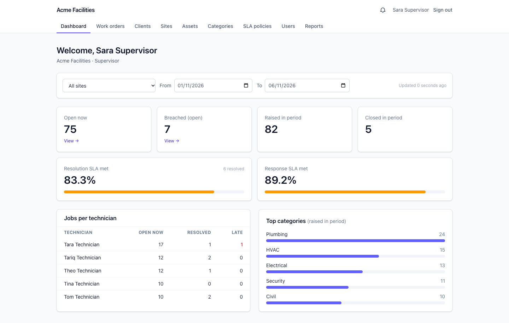

| | | |
|---|---|---|
| 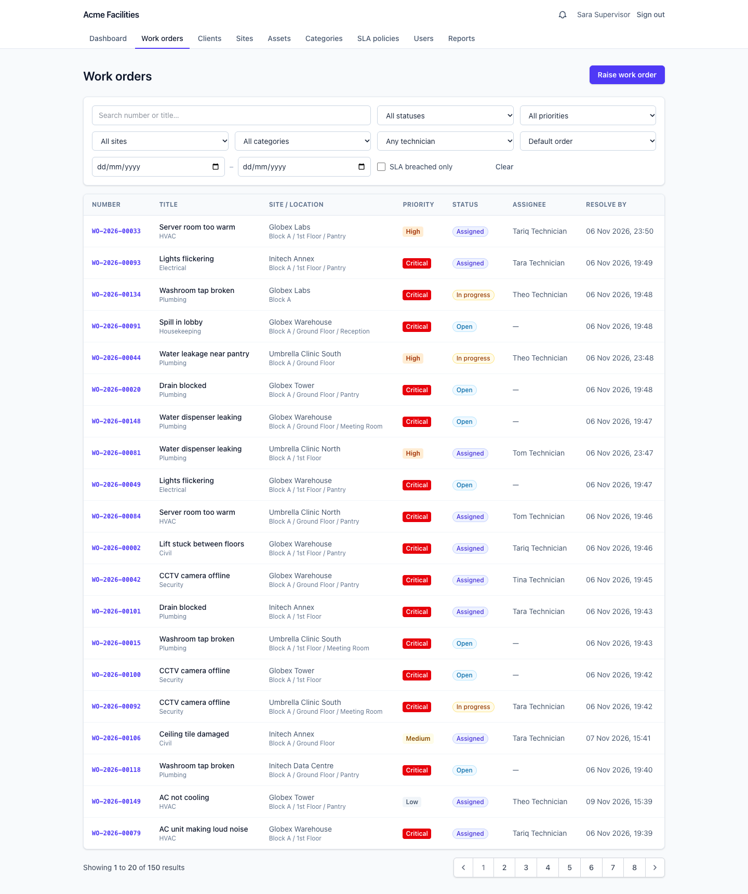 | 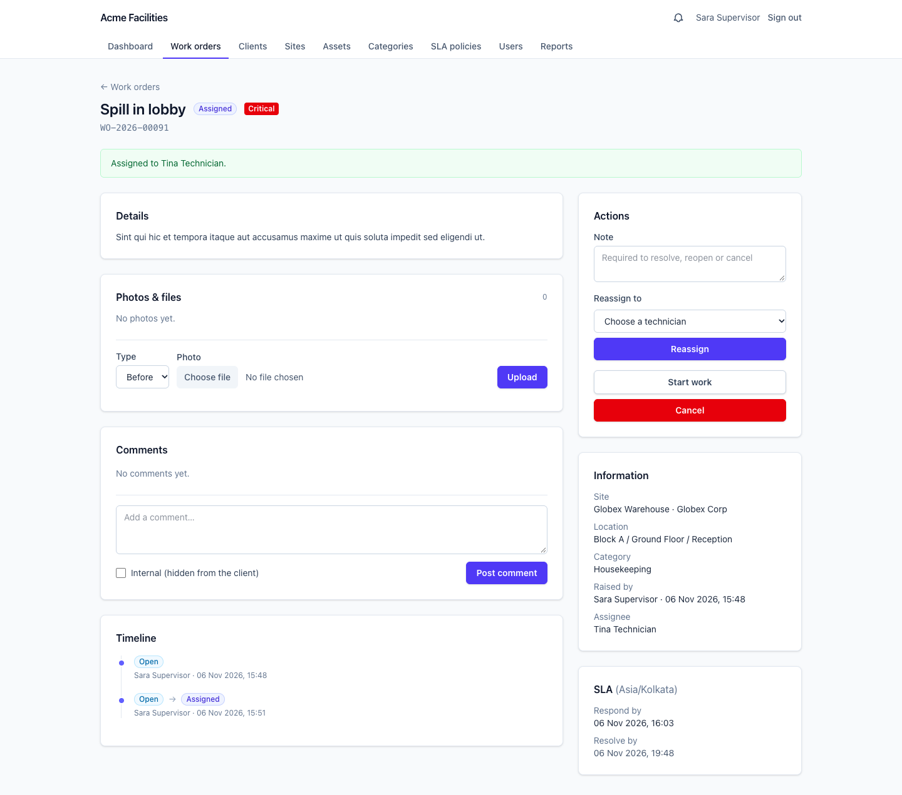 | 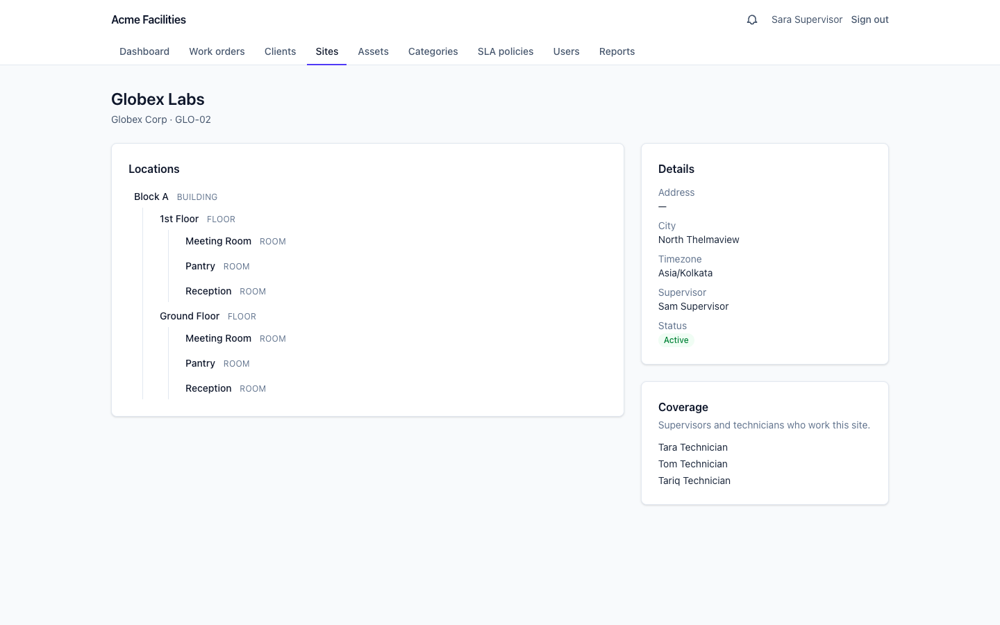 |
| Work order list with filters | Detail: actions, photos, comments, timeline | Sites with a location tree |
| 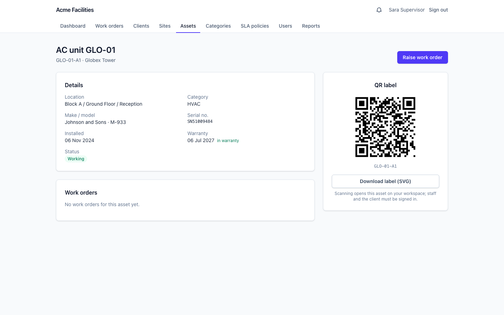 | 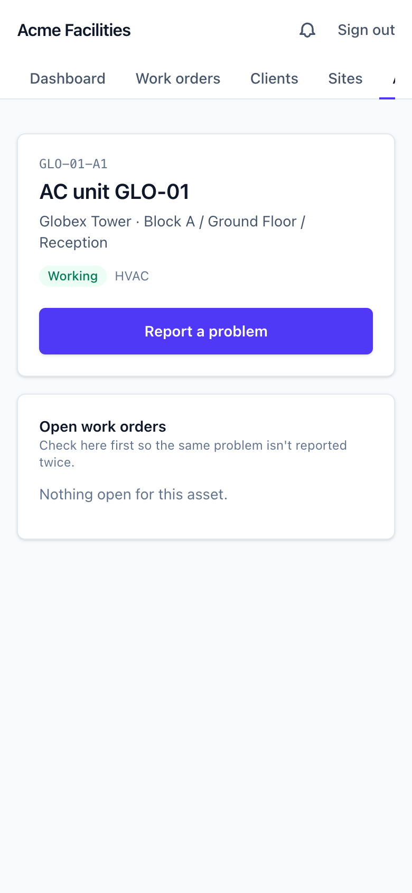 | 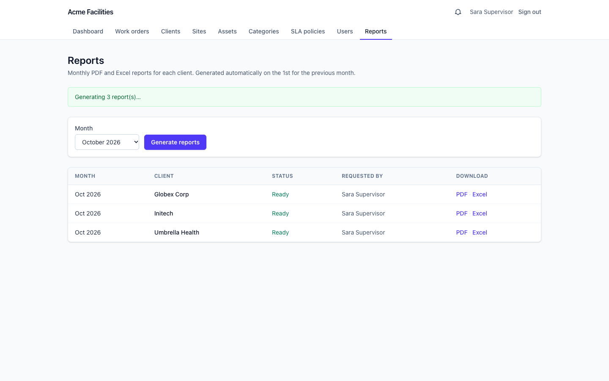 |
| Asset with printable QR label | Scanning the label on a phone | Monthly PDF/Excel reports |
| 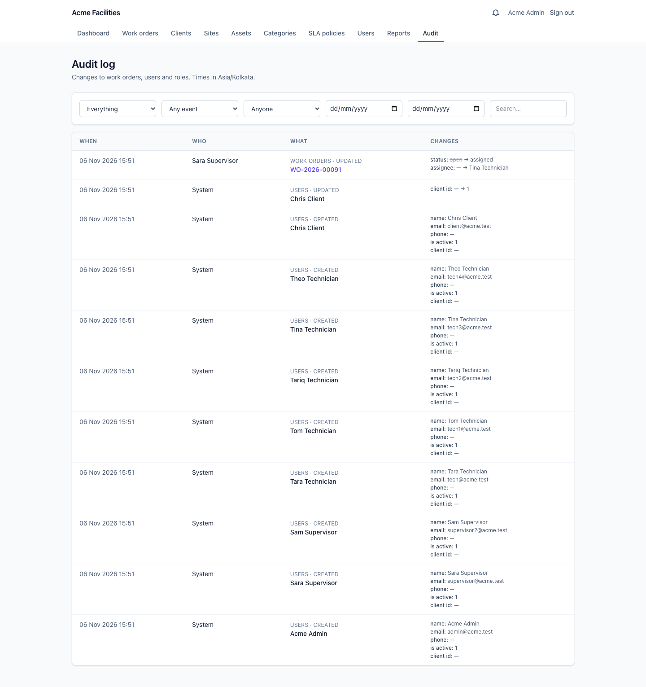 | 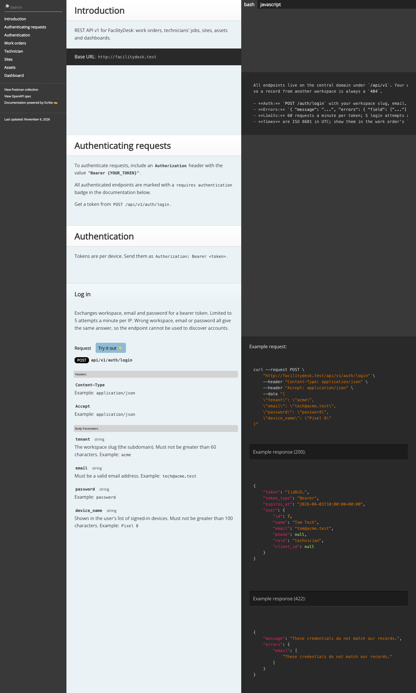 | 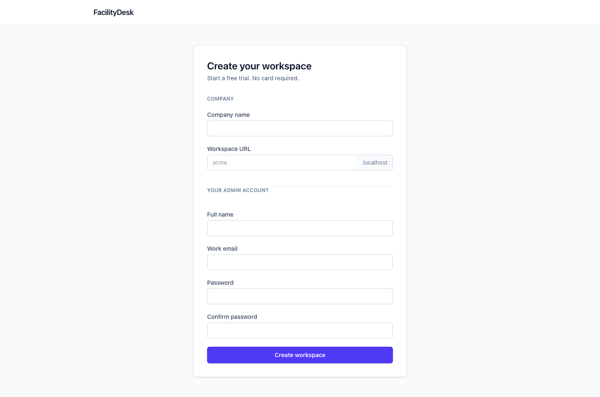 |
| Audit log (Tenant Admin) | REST API docs | Self-service signup |

## Try it

```bash
php artisan demo:seed     # two workspaces: acme and globex
```

| Role | Login (on `acme.<your domain>`) | Sees |
|---|---|---|
| Tenant Admin | `admin@acme.test` | everything in the workspace, users, SLA targets, audit log |
| Supervisor | `supervisor@acme.test` | all work orders, assigns technicians, dashboard, reports |
| Technician | `tech@acme.test` | only the jobs assigned to them; uploads before/after photos |
| Client User | `client@acme.test` | their own company's requests; confirms or reopens fixes |

Password for every account: `password`. The second workspace, `globex`, follows the same pattern. Setup is [below](#running-it-locally): with Sail the URL is <http://acme.facilitydesk.test>, without Docker <http://acme.localhost:8000>.

## What it does

- **Workspaces:** self-service signup creates a tenant with its roles, default SLA targets and categories in one transaction; each workspace lives on its own subdomain.
- **Master data:** clients, sites, a location tree per site (building → floor → room), categories, SLA targets per priority, assets with QR labels, technician skills and site coverage. Users are invited by email with a signed link.
- **Work orders:** raise (with up to 5 photos, or from a QR scan), assign, start, hold, resolve, confirm or reopen, with a status timeline, comments (some internal, hidden from the client) and before/after photos.
- **SLA engine:** response and resolution deadlines from the tenant's targets; time on hold pauses the clock; a 5-minute checker flags breaches and alerts supervisors once.
- **Notifications:** email plus an in-app bell when a job is raised, assigned, resolved or breaches its SLA, and an 08:00 daily digest in each tenant's own timezone.
- **Dashboard, reports, audit:** cached KPIs (SLA compliance, jobs per technician, top categories), monthly PDF and Excel reports per client generated in a background batch, and an audit log of who changed what.
- **REST API v1** for mobile apps: Sanctum tokens, 16 endpoints, OpenAPI spec and Postman collection.

## Architecture

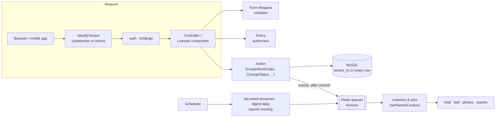

- **Thin entry points.** Web controllers, Livewire components and API controllers only validate (Form Requests and shared rule classes), authorise (Policies) and call an **Action**. Web and API call the same Actions, so they cannot drift apart.
- **Actions own the rules.** `ChangeStatus` is the only way a work order changes status: it locks the row, checks the policy and the state machine, applies side effects, writes the history row in the same transaction and fires an event after commit.
- **Side effects are queued.** Notifications, photo processing and reports run in queued listeners and jobs on four queues (`notifications`, `default`, `media`, `reports`), each with retries, backoff and a `failed()` handler.
- **Pure services where it matters.** `SlaCalculator` has no database and no clock of its own, so every SLA rule is unit-tested; `WorkOrderNumberGenerator` hands out gap-free per-tenant numbers under a row lock.

<details>
<summary>Project layout</summary>

```
app/
  Actions/        Tenants, Users, WorkOrders, Attachments, Locations, Reports …   business rules
  Auth/           tenant-aware password reset tokens
  Console/        sla:check-breaches, digest:daily, reports:monthly, tenancy:provision, demo:seed, app:benchmark
  Enums/          WorkOrderStatus (state machine), Priority, UserRole → permissions, …
  Events/ Listeners/ Jobs/ (+ Jobs/Middleware/SetTenantContext)
  Http/           Controllers/{Web,Api/V1}, Middleware, Requests, Resources
  Livewire/       Dashboard, WorkOrders/{Index,Create,Show}, Reports, Audit, NotificationBell
  Models/         + Concerns/BelongsToTenant
  Policies/  Queries/WorkOrderListQuery  Services/  Support/
tests/            Unit (state machine, SLA maths, architecture rules) · Feature (by module)
```
</details>

## Multi-tenancy

**Decision: one shared database with a `tenant_id` column on every tenant-owned table**, rather than a database per tenant. It keeps one schema to migrate, makes a new tenant free, and keeps platform-wide reporting simple. The cost is that isolation has to be enforced in code, so it is enforced in several layers and proven by tests:

1. **`IdentifyTenant`** resolves the tenant from the subdomain (web) or the bearer token's user (API) into a request-scoped `TenantContext`. It is registered in the middleware *priority list* ahead of authentication and route-model binding.
2. **`BelongsToTenant`** adds a global scope (`where tenant_id = ?`) to every tenant model and stamps `tenant_id` on create. It also applies to `User`, so a login on `acme.…` can only ever find Acme's users.
3. **Route-model binding goes through the scope**, so another tenant's record is a **404**, never a 403 that would confirm it exists. The API returns a bare `{"message": "Not found."}` that never names a model.
4. **Validation is tenant-pinned.** Laravel's `exists` and `unique` rules ignore Eloquent scopes, so they go through `TenantRules`.
5. **Queues and the scheduler.** Workers serve every tenant, so every job carries a `tenant_id` and runs through `SetTenantContext`; cross-tenant commands query explicitly with `withoutGlobalScope('tenant')`.
6. **Roles are per tenant** (spatie/laravel-permission teams keyed by `tenant_id`), kept in sync by `TenantContext`.

**Isolation bugs found and fixed while building it**, each now covered by a regression test:

- Laravel's middleware sorting moved route-model binding *ahead of* the tenant middleware, so `/users/{id}` could resolve another tenant's user before the scope existed. Fixed with the priority list.
- Password-reset tokens were keyed by email alone; with the same email in two tenants, a reset link issued by tenant B would also reset the account on tenant A. Tokens are now keyed by `(tenant_id, email)`.
- Livewire's default `/livewire/update` endpoint has no domain and no tenant middleware, so components would hydrate with no tenant set. A tenant-subdomain update route is registered before Livewire boots, and Livewire's assets load only in the tenant layout.

## Work order lifecycle and SLA

| From | Allowed next |
|---|---|
| open | assigned, cancelled |
| assigned | in progress, assigned (reassign), cancelled |
| in progress | on hold, resolved |
| on hold | in progress |
| resolved | closed (client or supervisor confirms), assigned (reopen) |

- The first move to "in progress" records the response time; resolving needs a note; cancelling and reopening need a reason.
- Due dates come from the tenant's SLA target for the priority (defaults: critical 15 min / 4 h, high 1 h / 8 h, medium 4 h / 1 day, low 1 day / 3 days).
- **On hold pauses the clock:** the time is added to `hold_minutes` and pushes the resolution deadline out, and an on-hold job is never flagged as late.
- **Breach alerts are idempotent:** a flag only flips false → true under a row lock and the alert fires only on that flip, so overlapping or repeated checker runs never alert twice.

## Background work

| Trigger | Work | Queue |
|---|---|---|
| Work order raised | email + bell to the site's supervisors | default |
| Assigned | email + bell to the technician | notifications |
| Resolved | email + bell to whoever raised it | default |
| Photo uploaded | rotate upright, cap at 1600 px, strip EXIF (including GPS), 320 px thumbnail | media |
| Every 5 min | `sla:check-breaches`: flag and alert the site supervisor and admins | notifications |
| Hourly | `digest:daily`: supervisors' summary at 08:00 in each tenant's timezone | notifications |
| Hourly | `reports:monthly`: on the tenant's local 1st, last month's reports as a `Bus::batch()` | reports |

Horizon runs two supervisors, one for short jobs and one for long report exports, so a slow export never delays a notification.

## REST API

Base URL `https://facilitydesk.test/api/v1` (the central domain; the workspace comes from the token, never from the URL or the body).

```bash
curl -X POST https://facilitydesk.test/api/v1/auth/login \
     -d tenant=acme -d email=tech@acme.test -d password=password -d device_name=cli
curl https://facilitydesk.test/api/v1/technician/jobs -H "Authorization: Bearer <token>"
```

16 endpoints cover auth, work orders (list, create with photos, detail, assign, status, comments, media), the technician job feed (cursor-paginated), sites and locations, QR lookup and the dashboard summary. Errors are always JSON `{ "message", "errors" }` with 401, 403, 404, 422 or 429. Limits are 60 requests a minute per token and 5 logins a minute per IP; tokens expire after 30 days.

**Docs:** `/docs` (static Scribe site), [`docs/openapi.yaml`](docs/openapi.yaml) and [`docs/postman_collection.json`](docs/postman_collection.json). Regenerate them with `composer docs`.

## Security

| Requirement | How |
|---|---|
| Tenant isolation | scope + policies on every model; cross-tenant 404s tested on web and API |
| No mass assignment of sensitive fields | explicit `$fillable`; a test fails if any model allows `tenant_id`, or a work order allows status, assignee, number or SLA fields |
| Uploads | JPG/PNG/WebP/PDF only, checked by content (a script renamed `.jpg` is rejected), 5 MB, private disk, random names, signed and authorised download URLs, EXIF stripped |
| Rate limiting | web login 5 attempts per email and IP, API login 5/min per IP, API 60/min per token |
| CSRF, API auth, CORS | CSRF on web; Sanctum bearer tokens only; CORS closed unless `CORS_ALLOWED_ORIGINS` lists an origin |
| Security headers | CSP with no inline script, `X-Frame-Options: DENY`, `nosniff`, `Referrer-Policy`, `Permissions-Policy`; HSTS in production over HTTPS |
| Internal comments | filtered out in the database query for client users, not just hidden in the view |
| Debug off in production | `APP_DEBUG` defaults to false; `deploy.sh` refuses to deploy production with debug on |

Moving confirmation dialogs off inline `onsubmit="…"` handlers for the CSP also closed a stored-XSS hole: a client named `x');alert(document.cookie);//` would have run script for any admin who clicked Delete.

## Performance

`php artisan demo:seed --large` adds 50,000 work orders (bulk inserts, about 8 s). `php artisan app:benchmark` runs the real list query (`WorkOrderListQuery`, shared by the web list and the API) and the uncached dashboard 15 times each and reports the median and the number of SQL statements. Measured on MariaDB 10.4 and PHP 8.2 on a MacBook, with 50,150 work orders in one tenant:

| Scenario | Before | After | Queries |
|---|---:|---:|---:|
| List, newest first, page 1 | 69.4 ms | 27.8 ms | 7 |
| List, newest first, page 100 | 76.8 ms | 29.6 ms | 7 |
| List, SLA breached only | 77.8 ms | 36.5 ms | 7 |
| List, search by title | 91.4 ms | 23.4 ms | 7 |
| List, by status / site / number | 6.1 / 5.3 / 1.8 ms | 5.1 / 6.2 / 2.0 ms | 7 |
| Technician job feed (cursor) | 4.1 ms | 4.7 ms | 6 |
| Dashboard, uncached (cached for 5 minutes otherwise) | 322.3 ms | 91.7 ms | 11 → 12 |

The causes came from `EXPLAIN`: the default list was a filesort over the whole tenant, fixed by an index on `(tenant_id, created_at)`; dashboard and report period counts were full scans, fixed by `(tenant_id, resolved_at | closed_at | responded_at)`; title search was `LIKE '%…%'`, now a MySQL FULLTEXT word-prefix search; and the per-technician breakdown was split into two index-friendly queries. There is **no N+1**: query counts are constant for any page size (tested), and lazy loading throws outside production. Report PDFs dropped from 882 KB to 29 KB with font subsetting.

## Running it locally

### With Sail (Docker)

```bash
cp .env.example .env
composer install
./vendor/bin/sail up -d                      # app, MySQL 8, Redis, Mailpit, MinIO (+ bucket)
./vendor/bin/sail artisan key:generate
./vendor/bin/sail artisan migrate
./vendor/bin/sail artisan demo:seed
./vendor/bin/sail npm install && ./vendor/bin/sail npm run build
./vendor/bin/sail artisan horizon            # queues
./vendor/bin/sail artisan schedule:work      # SLA checks, digests, reports
```

Add `127.0.0.1 facilitydesk.test acme.facilitydesk.test globex.facilitydesk.test` to `/etc/hosts`, then open <http://acme.facilitydesk.test>. Mail lands in Mailpit at <http://localhost:8025>.

### Without Docker

You need PHP 8.2+ with `pdo_mysql` (or SQLite), `gd`, `zip` and `exif`. In `.env` set `APP_DOMAIN=localhost`, `APP_URL=http://localhost:8000`, `QUEUE_CONNECTION=database`, `CACHE_STORE=file`, `SESSION_DRIVER=file`, `ATTACHMENTS_DISK=local` and `MAIL_MAILER=log`, then:

```bash
php artisan migrate && php artisan demo:seed && npm install && npm run build
composer dev                # server + queue worker + logs + Vite
php artisan schedule:work   # in another terminal
```

Browsers resolve `*.localhost` to 127.0.0.1, so <http://acme.localhost:8000> works without editing `/etc/hosts`. With `MAIL_MAILER=log`, emails (including their links) are written to `storage/logs/laravel.log`.

## Tests and quality

```bash
composer test       # Pest: 479 tests (SQLite in memory)
composer lint       # Pint
composer analyse    # Larastan level 6
```

CI ([`.github/workflows/ci.yml`](.github/workflows/ci.yml)) runs Pint, Larastan and the suite against **MySQL 8.4 and Redis**, in parallel, with a 70% coverage minimum. Highlights include every allowed and disallowed status change (49 cases), SLA maths per priority including hold time, cross-tenant 404s on every web and API route type, idempotent breach alerts, sequential per-tenant numbers, EXIF stripping on a real JPEG, architecture rules (strict types everywhere, no database access in controllers, final actions) and a mass-assignment guard on every model.

## Deploying

[`deploy.sh`](deploy.sh) targets a single app server. It runs a preflight check (it refuses to deploy production with `APP_DEBUG=true`), enters maintenance mode with an automatic `up` even if a step fails, then runs `git pull --ff-only`, `composer install --no-dev -o`, `npm ci && npm run build`, `migrate --force` and `tenancy:provision` (an idempotent role and permission sync for every tenant). It rebuilds the config, route, view and event caches, then runs `horizon:terminate` and `queue:restart` so workers pick up the new code. Production also needs a cron entry for `php artisan schedule:run` every minute, Horizon under Supervisor or systemd, `SESSION_SECURE_COOKIE=true` and HTTPS.

## Decisions worth discussing

- **Shared database over database-per-tenant**, with isolation layered in code and proven by tests (see [Multi-tenancy](#multi-tenancy)).
- **Roles per tenant, permissions global.** Tenants can later tailor their roles; the role → permission map lives in `UserRole::permissions()`, and `tenancy:provision` re-syncs every tenant safely.
- **One `ChangeStatus` action with a row lock**, instead of status updates scattered across controllers.
- **Version-key cache invalidation** for the dashboard: one write expires every filter combination on any cache store, with no need for Redis tags.
- **Timezone-correct scheduling:** digests and monthly reports run hourly and act for each tenant when it is the right *local* time, instead of at a single UTC time that is wrong for half the world.
- **PHP 8.2-compatible code** with PHP 8.3 in Sail and CI, because the development machine runs 8.2. This is also why `maatwebsite/excel` 3.1 and `spatie/laravel-activitylog` 4.x are used.
- **Livewire and Blade instead of an SPA:** server-rendered pages keep every rule on the server, while the REST API serves mobile clients.

**Not built yet:** a Super Admin panel (tenant list, plans, suspension, platform stats; suspension is enforced, but there is no UI for it). Out of scope for v1: a native mobile app, tenant billing, IoT and multiple UI languages.
